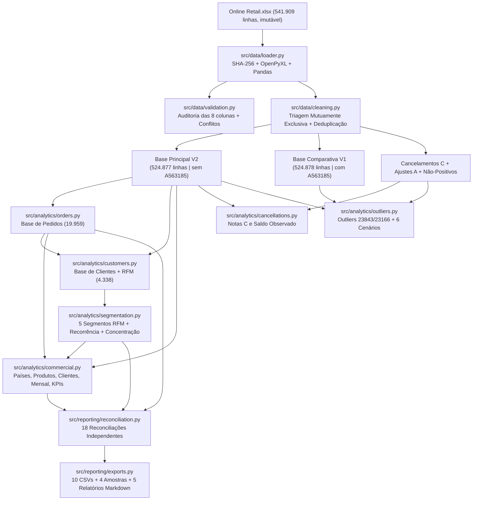

# Online Retail Customer Analytics V2

Evolução profissional da minha análise exploratória original em notebook (`projeto.ipynb`) para uma solução modular, auditável e reproduzível de **Customer Analytics e Inteligência Comercial** em Python, Pandas, OpenPyXL e Pytest, sobre a base oficial **Online Retail** da UCI Machine Learning Repository.

---

## 1. Problema Empresarial e Objetivo

A versão original (V1) respondia a perguntas iniciais de faturamento, ticket médio, países, produtos e clientes em um único notebook, mas deixava lacunas relevantes de granularidade, qualidade de dados, comportamento de clientes e validação matemática.

Nesta V2, o objetivo é responder de forma auditável e reproduzível a nove perguntas centrais de negócio:

1. Quais clientes apresentam maior valor comercial histórico?
2. Quais clientes realizam compras recorrentes no período observado?
3. Quais clientes compraram recentemente?
4. Quais clientes estão há mais tempo sem compras observadas?
5. Quanto do faturamento está concentrado nos principais clientes, produtos e mercados?
6. Quais países apresentam maior volume comercial — e onde o ticket médio alto é distorcido por amostra pequena?
7. Quais produtos lideram receita e volume quando consolidados corretamente por código?
8. Qual é a influência dos cancelamentos (`InvoiceNo` com prefixo `C`), ajustes contábeis (`A563185`) e pedidos atípicos (`581483` e `541431`) sobre os indicadores?
9. Quais frentes comerciais merecem investigação futura (sem afirmar resultados comerciais comprovados ou retorno financeiro)?

---

## 2. Fonte, Autoria, Licença e Integridade do Dataset

| Atributo | Especificação verificada |
|---|---|
| **Dataset** | Online Retail |
| **Fonte oficial** | [UCI Machine Learning Repository (ID 352)](https://archive.ics.uci.edu/dataset/352/online+retail) |
| **DOI** | [https://doi.org/10.24432/C5BW33](https://doi.org/10.24432/C5BW33) |
| **Autoria original** | Daqing Chen (School of Engineering, London South Bank University) |
| **Licença** | [CC BY 4.0](https://creativecommons.org/licenses/by/4.0/) |
| **Dimensões verificadas** | `541.909` linhas × `8` colunas (`23.715.344` bytes / `22,62 MB`) |
| **Período efetivo** | `2010-12-01 08:26:00` a `2011-12-09 12:50:00` (**dezembro/2011 incompleto**) |
| **Moeda** | Libra esterlina (`GBP` / `£`) |
| **SHA-256 verificado** | `43465a06f2ccf7c8b5bd2892bc7defb52f97487934fe93b16ae4c3936424676d` |

O arquivo bruto `Online Retail.xlsx` e o notebook histórico `projeto.ipynb` foram preservados intactos na raiz do repositório para manter a reprodução histórica da V1. Instruções de obtenção e verificação de hash estão em [data/README.md](data/README.md).

---

## 3. Arquitetura do Pipeline



---

## 4. Granularidade das Bases Analíticas

| Base | Chave lógica | Volume V2 | Cuidados implementados |
|---|---|---:|---|
| **Transacional** | 1 linha por lançamento de item válido | `524.877` linhas | Ausência de `LineItemID` documentada; `5.226` duplicatas exatas medidas e avaliadas em sensibilidade. |
| **Pedidos** | 1 linha por `InvoiceNo` válido | `19.959` pedidos | Validação prévia de 0 conflitos de `CustomerID` e `Country`; `42` pedidos com 2 timestamps (60s) resolvidos com `min(InvoiceDate)`. |
| **Produtos** | 1 linha por `StockCode` maiúsculo | `3.811` códigos | Unifica variações de caixa (`85123A`/`85123a`) e evita fragmentação por múltiplas descrições (caso `22197`). |
| **Clientes** | 1 linha por `CustomerID` identificado | `4.338` clientes | Exclui `1.427` pedidos sem `CustomerID` (`£ 1.743.839,85`, `16,40%`), mantidos nas análises gerais e reconciliados. |

---

## 5. Metodologia RFM e Regras de Segmentação

A análise RFM usa **data de referência fixa em `2011-12-10`** (1 dia após a última transação observada em `2011-12-09`), evitando `datetime.now()` para garantir reprodutibilidade:

- **Recency (`recencia_dias`):** dias corridos entre `2011-12-10` e a última compra válida normalizada.
- **Frequency (`frequencia`):** quantidade de pedidos distintos (`InvoiceNo`) do cliente no período.
- **Monetary (`valor_monetario`):** faturamento bruto acumulado das vendas válidas (não é lucro nem CLV).

Todos os `4.338` clientes elegíveis são classificados exatamente uma vez por regras transparentes em `if/elif/else` (sem `qcut` nem K-Means), nesta ordem de prioridade:

1. **Alto valor e recorrentes:** `frequência >= 5`, `valor monetário >= £ 1.500,00` e `recência <= 90 dias`.
2. **Recorrentes recentes:** `frequência >= 2` e `recência <= 90 dias`.
3. **Compra única recente:** `frequência == 1` e `recência <= 90 dias`.
4. **Recorrentes há mais tempo sem compras:** `frequência >= 2` e `recência > 90 dias`.
5. **Compra única há mais tempo sem compras:** `frequência == 1` e `recência > 90 dias`.

> Os limites foram ancorados nos quartis observados da base (ex.: 75% dos clientes têm até 5 pedidos e até £ 1.660,60), não representam padrões universais de mercado e não classificam clientes inativos há mais de 90 dias como definitivamente perdidos.

---

## 6. Resultados Comerciais Verificados (V1 vs V2)

| Indicador | V1 Histórica (reproduzida) | Base Principal V2 | Explicação da diferença |
|---|---:|---:|---|
| Linhas de transação mantidas | `524.878` | **`524.877`** | V2 exclui o lançamento contábil `A563185` (`Adjust bad debt`, £ 11.062,06) |
| Pedidos válidos distintos | `19.960` | **`19.959`** | `A563185` tinha entrado como pedido na V1 |
| Faturamento de vendas positivas | `£ 10.642.110,80` (`10642110.804`) | **`£ 10.631.048,74`** (`10631048.744`) | Precisão de 3 casas preservada em `Decimal` (4 registros com `UnitPrice = 0.001`) |
| Ticket médio geral | `£ 533,17` | **`£ 532,64`** | Calculado como `faturamento total / pedidos distintos` |
| Clientes identificados | `4.338` | **`4.338`** | `83,60%` da receita V2 (`£ 8.887.208,89`); `16,40%` (`£ 1.743.839,85`) sem `CustomerID` |
| Cliente líder em receita | `14646` (`£ 280.206,02`) | **`14646` (`£ 280.206,02`)** | `73` pedidos, `196.915` unidades, país principal `Netherlands` |
| Taxa de recorrência observada | — | **`65,58%`** | `2.845` clientes com `>= 2` pedidos vs `1.493` (`34,42%`) com 1 pedido |
| Reconciliação matemática | — | **`18/18 aprovadas`** | 0 divergências entre todas as camadas analíticas |

### Resumo dos Segmentos RFM (`resumo_segmentos.csv`)

| Segmento RFM | Clientes | % Clientes | Faturamento | % Receita Ident. | Ticket Médio | Freq. Média | Recência Média |
|---|---:|---:|---:|---:|---:|---:|---:|
| Alto valor e recorrentes | `840` | `19,36%` | `£ 5.954.738,26` | `67,00%` | `£ 564,54` | `12,56` | `20,4 d` |
| Recorrentes recentes | `1.403` | `32,34%` | `£ 1.642.178,58` | `18,48%` | `£ 353,16` | `3,31` | `33,2 d` |
| Compra única recente | `646` | `14,89%` | `£ 257.749,76` | `2,90%` | `£ 398,99` | `1,00` | `46,0 d` |
| Recorrentes há mais tempo sem compras | `602` | `13,88%` | `£ 676.302,49` | `7,61%` | `£ 367,36` | `3,06` | `174,8 d` |
| Compra única há mais tempo sem compras | `847` | `19,53%` | `£ 356.239,80` | `4,01%` | `£ 420,59` | `1,00` | `242,1 d` |

---

## 7. Principais Descobertas, Cancelamentos e Valores Atípicos

### Principais Descobertas de Negócio
- **Forte concentração comercial:** `840` clientes **Alto valor e recorrentes** (`19,36%`) geram **`67,00%`** da receita identificada; `391` clientes com `10+` pedidos (`9,01%`) geram **`51,31%`**. Os Top 10 clientes respondem por `17,30%` e os Top 50 por `33,30%` da receita identificada.
- **Assimetria severa de gasto:** a média de valor monetário por cliente (`£ 2.048,69`) é mais de 3× superior à mediana (`£ 668,57`).
- **Armadilha de baixa amostra geográfica:** Singapura liderou o ticket médio da V1 (`£ 3.039,90`), mas com apenas **`7` pedidos** (`£ 21.279,29`) e **`-£ 12.158,90`** em cancelamentos (`57,14%` sobre suas vendas positivas). Reino Unido concentra `84,57%` da receita (`18.018` pedidos).
- **Clientes em múltiplos países:** `8` clientes compraram em 2 países diferentes (soma por país = `4.346` vs total real = `4.338`).
- **Fragmentação corrigida na V2:** o produto `22197` (`POPCORN HOLDER` + `SMALL POPCORN HOLDER`), dividido em duas linhas na V1, soma **`56.898` unidades** quando consolidado por `StockCode`, assumindo a liderança de volume quando os dois maiores outliers são retirados.

### Análise de Cancelamentos e Saldo Observado
- **Notas de cancelamento (`InvoiceNo` com prefixo `C`):** `9.288` linhas brutas (`9.251` deduplicadas), `3.836` notas distintas, totalizando **`-£ 893.979,73`** deduplicados (`8,41%` das vendas positivas V2; `-£ 896.812,49` ou `8,44%` no bruto).
- **Quantidades negativas sem prefixo `C`:** `1.336` linhas (`-206.957` unidades), **todas com `UnitPrice == 0`** (avarias/descartes/ajustes de estoque), não tratadas como devoluções comerciais.
- **Saldo monetário observado:** `£ 10.631.048,744 + (-£ 893.979,730) =` **`£ 9.737.069,01`** (`9737069.014`). Valor estritamente descritivo — **não equivale a faturamento líquido contábil certificado**, pois a fonte não vincula notas `C` aos pedidos originais.

### Análise de Valores Atípicos e Sensibilidade (`relatorio_sensibilidade.md`)
- **`581483` (`23843` — `PAPER CRAFT , LITTLE BIRDIE`):** `80.995` unidades (`£ 168.469,60`, cliente `16446`, `100%` do volume do produto), seguido 12 minutos depois pela nota `C581484` de `-80.995` unidades.
- **`541431` (`23166` — `MEDIUM CERAMIC TOP STORAGE JAR`):** `74.215` unidades (`£ 77.183,60`, cliente `12346`, `95,11%` do volume do produto), seguido 16 minutos depois pela nota `C541433` de `-74.215` unidades.
- Sem afirmar vínculo comprovado (ausência de chave estrangeira), a tabela abaixo compara os 6 cenários de sensibilidade preservando intacta a Base Principal V2:

| Cenário | Pedidos | Unidades | Faturamento | Variação vs Base V2 | Ticket Médio | Líder em Unidades |
|---|---:|---:|---:|---:|---:|---|
| 1. Base Principal V2 | `19.959` | `5.572.419` | `£ 10.631.048,74` | `0,00%` | `£ 532,64` | `23843` (`80.995`) |
| 2. Reprodução Histórica V1 (`+A563185`) | `19.960` | `5.572.420` | `£ 10.642.110,80` | `+0,10%` | `£ 533,17` | `23843` (`80.995`) |
| 3. Sem Remoção de Duplicatas Exatas | `19.959` | `5.588.375` | `£ 10.655.622,48` | `+0,23%` | `£ 533,88` | `23843` (`80.995`) |
| 4. Sem Outlier Principal (`581483`) | `19.958` | `5.491.424` | `£ 10.462.579,14` | `-1,58%` | `£ 524,23` | `23166` (`78.033`) |
| 5. Sem Dois Maiores Outliers (`581483` e `541431`) | `19.957` | `5.417.209` | `£ 10.385.395,54` | `-2,31%` | `£ 520,39` | `22197` (`56.898`) |
| 6. Apenas Mercadorias (sem códigos operacionais) | `19.773` | `5.561.384` | `£ 10.247.219,32` | `-3,61%` | `£ 518,24` | `23843` (`80.995`) |

---

## 8. Captura Real da Execução (Testes + Pipeline V2)

```text
$ .\.venv\Scripts\python.exe -m pytest -v
============================= 29 passed in 3.80s ==============================

$ .\.venv\Scripts\python.exe main.py
========================================================================
ONLINE RETAIL CUSTOMER ANALYTICS V2
========================================================================
Data de referência RFM : 2011-12-10
Diretório de saída     : ...\online-retail-sales-analysis\reports
------------------------------------------------------------------------
Arquivo processado     : Online Retail.xlsx
SHA-256                : 43465a06f2ccf7c8b5bd2892bc7defb52f97487934fe93b16ae4c3936424676d
Linhas brutas          : 541.909
Linhas válidas V2      : 524.877
Pedidos válidos V2     : 19.959
Faturamento V2 (exato) : £ 10.631.048,74 (£ 10631048.744)
Ticket médio geral V2  : £ 532.64
Clientes identificados : 4.338
Taxa de recorrência    : 65.58%
Cancelamentos (dedup.) : 3836 notas | £ -893.979,73 (8.41% das vendas V2)
Reconciliação          : 18/18 aprovadas (OK)
CSVs exportados        : 10
Relatórios Markdown    : 5
Tempo total            : 103.19 s
========================================================================
```

---

## 9. Estrutura do Repositório

```text
online-retail-sales-analysis/
├── Online Retail.xlsx              # Dataset bruto original da UCI (intacto para V1 e V2)
├── projeto.ipynb                   # Notebook original da V1 (preservado sem alterações)
├── main.py                         # CLI e ponto de entrada do pipeline V2
├── requirements.txt                # Dependências mínimas (pandas, openpyxl, pytest)
├── README.md                       # Visão executiva e técnica do projeto
├── data/
│   └── README.md                   # Fonte oficial, DOI, licença, SHA-256 e instruções
├── src/
│   ├── config.py                   # Constantes, data fixa RFM, limiares e política GBP
│   ├── pipeline.py                 # Orquestração ponta a ponta
│   ├── data/
│   │   ├── loader.py               # Carga Excel/CSV, SHA-256 e inspeção de precisão
│   │   ├── validation.py           # Esquema, auditoria de qualidade e conflitos de pedido
│   │   └── cleaning.py             # Triagem mutuamente exclusiva, deduplicação e V1 vs V2
│   ├── analytics/
│   │   ├── orders.py               # Base de pedidos com somas exatas Decimal
│   │   ├── customers.py            # Base de clientes, RFM e gap sem CustomerID
│   │   ├── segmentation.py         # 5 segmentos RFM, recorrência e concentração
│   │   ├── commercial.py           # Países, produtos, clientes, evolução mensal e KPIs
│   │   ├── cancellations.py        # Cancelamentos C, negativos sem C e saldo observado
│   │   └── outliers.py             # Outliers 23843/23166 e 6 cenários de sensibilidade
│   └── reporting/
│       ├── reconciliation.py       # 18 verificações independentes + Decimal vs float64
│       └── exports.py              # 10 CSVs + 4 amostras verificadas + 5 relatórios MD
├── tests/                          # 29 testes Pytest (sintéticos manuais + regressão + integração + AST)
├── reports/                        # Relatórios Markdown, CSVs compactos e amostras top-50
└── docs/                           # Arquitetura, dicionário, regras e metodologia
```

---

## 10. Como Instalar, Reproduzir e Testar

```bash
# 1. Crie e ative um ambiente virtual limpo
python -m venv .venv
# Windows (PowerShell):
.\.venv\Scripts\Activate.ps1
# Linux / macOS:
# source .venv/bin/activate

# 2. Instale as dependências mínimas
pip install -r requirements.txt

# 3. Execute os testes automatizados
python -m pytest -v

# 4. Execute o pipeline completo (gera todos os CSVs e relatórios em reports/)
python main.py
```

### Reprodução Exata do Ambiente vs Compatibilidade Entre Versões

- **Reprodução exata do ambiente oficial (`requirements.txt` fixado):** `Python 3.12.7`, `pandas==3.0.6`, `openpyxl==3.1.5`, `pytest==8.4.2`. Este conjunto reproduz os `29` testes sem avisos, as `18` reconciliações e todos os `15/15` arquivos de relatório byte a byte.
- **Compatibilidade entre versões (validada em ambiente separado):** testado com `pandas==2.2.3`, `openpyxl==3.1.5` e `pytest==9.0.2`, mantendo `100%` dos indicadores comerciais, `18/18` reconciliações e `0 FutureWarning`, com diferença esperada apenas na exibição textual de `dtypes` no `relatorio_qualidade.md` (`object`/`datetime64[ns]` no Pandas 2.2.x vs `str`/`datetime64[us]` no Pandas 3.0.x).

Opções úteis da CLI:
- `python main.py --input caminho/para/Online\ Retail.xlsx --output pasta_saida`
- `python main.py --reference-date 2011-12-10`
- `python main.py --skip-precision-scan` (pula a leitura auxiliar célula-a-célula do Excel para reexecuções mais rápidas)

---

## 11. Limitações Metodológicas

1. **Sem dados de custo:** impossível calcular lucro, margem ou retorno financeiro.
2. **Sem chave única de item (`LineItemID`):** a remoção de duplicatas exatas (`5.226` linhas) é preservada para comparabilidade com a V1 e avaliada em sensibilidade, sem presunção absoluta de erro em todas as ocorrências.
3. **Sem chave de vínculo para cancelamentos:** notas `C` não podem ser associadas com certeza documental aos pedidos originais.
4. **Cobertura parcial de clientes:** `16,40%` da receita V2 (`1.427` pedidos) não possuem `CustomerID`.
5. **Censura temporal e dezembro/2011 incompleto:** a base termina em `09/12/2011` (`2011-12` cobre apenas 9 dias), a primeira compra na base não garante ser a primeira da vida do cliente, e recorrência no período não equivale a retenção de longo prazo.
6. **Limites naturais de precisão numérica do Excel (`.xlsx`):** células numéricas em planilhas `.xlsx` usam ponto flutuante IEEE-754 de 64 bits (53 bits de significando, ~15 dígitos decimais exatos), de modo que inteiros acima de `2**53` perdem precisão na origem se gravados como número no Excel (só preservam exatidão no Excel quando armazenados como texto). Já na ingestão de arquivos `.csv`, o projeto lê com `dtype=str` e valida via `int`/`Decimal`, preservando precisão integral acima de `2**53`. O uso de `Decimal(str(...))` elimina erros acumulados de soma, mas depende da representação recebida da planilha.

---

## 12. Minha Contribuição e Assistência de IA

Eu desenvolvi originalmente a V1 deste projeto em notebook ([projeto.ipynb](projeto.ipynb)), aplicando meus conhecimentos de Python e Pandas para limpar a base, consolidar pedidos, calcular ticket médio, ranquear países, produtos e clientes e identificar inicialmente o pedido atípico de `80.995` unidades.

Para evoluir o projeto para a V2, defini as restrições técnicas compatíveis com o meu nível atual, acompanhei a auditoria detalhada da V1, aprovei explicitamente a exclusão do ajuste contábil `A563185` na base principal, validei as regras transparentes de segmentação RFM e autorizei um conjunto enxuto de métodos adicionais de Pandas e biblioteca padrão (`str`, `duplicated`, `isin`, `merge`, `min`/`max`/`first`, `.dt.normalize`/`.dt.days`/`.dt.strftime`, `median`, `ROUND_HALF_UP` e `argparse`).

Contei com assistência de inteligência artificial para estruturar a arquitetura modular em `src/`, implementar a bateria de 18 reconciliações matemáticas, construir a suíte de 29 testes em Pytest e redigir a documentação técnica e de aprendizagem em `docs/`. **Não apresento os recursos assistidos por IA como domínio autônomo já consolidado**; sigo estudando e praticando para reconstruir as análises com autonomia.
