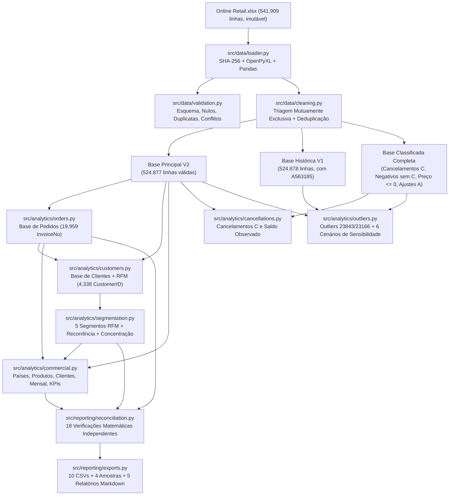

# Arquitetura — Online Retail Customer Analytics V2

## 1. Visão Geral e Princípios Arquiteturais

A V2 transforma a análise exploratória originalmente concentrada em um único notebook ([projeto.ipynb](../projeto.ipynb)) em uma arquitetura **procedural, modular, auditável e reproduzível**, sem introduzir complexidade artificial (sem classes desnecessárias, sem bancos de dados externos, sem bibliotecas proibidas).

### Princípios adotados
1. **Separação clara de responsabilidades:** cada módulo executa uma etapa bem definida (carga, validação, limpeza, pedidos, clientes/RFM, segmentação, comercial, cancelamentos, outliers/sensibilidade, reconciliação e exportação).
2. **Preservação integral da V1 e dos dados brutos:** `Online Retail.xlsx` e `projeto.ipynb` permanecem intactos em seus caminhos originais.
3. **Reprodutibilidade determinística:** data de referência fixa (`2011-12-10`), ordenações com chaves de desempate explícitas, política monetária em `Decimal` (`ROUND_HALF_UP`) e exportações UTF-8 com LF determinístico.
4. **Transparência sobre conflitos e limitações:** conflitos de granularidade geram erro explícito em vez de serem ocultados por `first`; casos atípicos permanecem na base principal e são comparados em cenários de sensibilidade.

## 2. Fluxo de Dados (Mermaid)

## 3. Mapa de Módulos e Responsabilidades

| Arquivo | Responsabilidade principal | Funções centrais |
|---|---|---|
| `main.py` | Ponto de entrada CLI (`argparse`, código de saída `sys.exit`) e resumo de terminal | `parse_args`, `main` |
| `src/config.py` | Metadados UCI, SHA-256 oficial, data fixa RFM, limiares de segmentação, política GBP | `quantize_gbp`, `to_decimal`, `format_gbp` |
| `src/pipeline.py` | Orquestração sequencial ponta a ponta e medição de tempo (`time.perf_counter`) | `run_customer_analytics_pipeline` |
| `src/data/loader.py` | Resolução de caminho, cálculo de SHA-256, leitura via OpenPyXL/Pandas e auditoria de precisão | `resolve_data_path`, `calculate_sha256`, `inspect_excel_workbook_metadata`, `load_raw_dataset` |
| `src/data/validation.py` | Validação de esquema, auditoria das 8 colunas e validação pré-agregação de pedidos | `validate_required_schema`, `audit_raw_data_quality`, `validate_order_level_consistency` |
| `src/data/cleaning.py` | Padronização de tipos, triagem mutuamente exclusiva, deduplicação e base comparativa V1 | `standardize_raw_dataframe`, `classify_raw_record`, `classify_all_records`, `build_clean_datasets` |
| `src/analytics/orders.py` | Consolidação da base de pedidos após checar conflitos e somas exatas `Decimal` | `sum_decimal_by_key`, `build_orders_table` |
| `src/analytics/customers.py` | Base de clientes identificados, RFM com data fixa e quantificação da receita sem `CustomerID` | `build_customers_rfm_table` |
| `src/analytics/segmentation.py` | Classificação RFM em `if/elif/else`, resumo por segmento, recorrência e concentração | `classify_rfm_segment`, `apply_rfm_segmentation`, `summarize_rfm_segments`, `analyze_recurrence_and_concentration` |
| `src/analytics/commercial.py` | KPIs executivos, países com porte amostral, produtos, ranking de clientes e evolução mensal | `analyze_countries`, `build_product_ranking`, `build_customer_ranking`, `build_monthly_evolution`, `build_executive_kpis` |
| `src/analytics/cancellations.py` | Análise separada de notas `C`, negativos sem `C`, preço zerado, prefixo `A` e saldo observado | `analyze_cancellations_and_anomalies` |
| `src/analytics/outliers.py` | Investigação de `23843`/`23166`, busca de cancelamentos compatíveis e 6 cenários de sensibilidade | `investigate_primary_outliers`, `run_sensitivity_analysis` |
| `src/reporting/reconciliation.py` | Bateria independente de 18 reconciliações (linhas, receita, pedidos, unidades, clientes, moeda) | `run_reconciliation` |
| `src/reporting/exports.py` | Geração determinística dos CSVs, amostras top-50 e 5 relatórios Markdown | `export_csv_reports`, `export_markdown_reports` |

## 4. Decisões Arquiteturais Relevantes

1. **Procedural em vez de Orientação a Objetos pesada:** como o domínio é um pipeline analítico linear sobre DataFrames e dicionários de auditoria, funções puras e módulos pequenos tornam o fluxo muito mais fácil de depurar, testar e reconstruir manualmente.
2. **Preservação do arquivo bruto na raiz (`Online Retail.xlsx`):** evita quebrar o caminho relativo de `projeto.ipynb` e mantém compatibilidade retroativa com a V1.
3. **Dupla representação monetária (`valor_linha` float64 + `valor_linha_decimal` Decimal):** combina a ergonomia/velocidade das agregações Pandas com a exatidão contábil de `Decimal` nas reconciliações e relatórios finais, sem arredondar antecipadamente os 4 registros de `0.001` GBP.
4. **Separação entre grandes CSVs derivados e amostras versionadas:** todos os CSVs completos são reproduzidos via `python main.py`, enquanto apenas resumos compactos, relatórios Markdown e amostras verificadas (`reports/samples/`) são versionados no Git.
